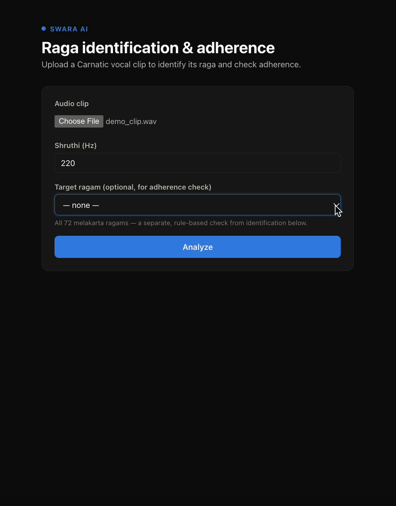

# Swara AI



A Carnatic vocal analysis system that checks whether a singer stays within a raga and identifies the raga from a recording alone. Every recording is converted to pitch relative to the singer's tonic (shruthi) before any analysis, so results do not depend on which key the singer chose.

## Why this project

Standard music classifiers perform poorly on Carnatic vocal audio because the same raga sung at two different shruthis produces entirely different absolute pitches. A model trained on raw spectrograms learns the singer's tonic instead of the raga's structure. Swara AI avoids this by converting all pitch to cents relative to the singer's shruthi before any rule or model sees it.

## Results

Raga identification on 10 ragas from the Saraga dataset (track-level macro-F1, same splits for every model):

| Model | Val macro-F1 (10 tracks) | Test macro-F1 (12 tracks) | Params | Inference latency |
|---|---|---|---|---|
| BiLSTM + attention | 0.867 | **0.717** | 630,154 | 9.31 ms |
| SVM (swara histograms) | 0.733 | 0.567 | 8,208 | 0.06 ms |
| MLP (window aggregates) | 0.400 | 0.190 | 1,882 | 0.18 ms |

Unlike the baselines, the BiLSTM uses the order of swaras. The MLP scores 0.190, about twice chance (0.10 for 10 ragas).

The test set is small: 12 tracks, one or two per raga, so a single misclassified track can move macro-F1 by 0.1 or more. Both validation scores are optimistically biased because the LSTM was early-stopped on the validation set and the SVM's C and gamma were grid-searched on it. The test set therefore provides the unbiased comparison.

**LSTM test detail:** accuracy 0.750, macro-F1 0.717, weighted-F1 0.736. Bēgaḍa and Rītigauḷa each have one test track, and both were misclassified, so each scores 0 F1. The full breakdown is in [`models/confusion_matrix.csv`](models/confusion_matrix.csv), [`models/confusion_matrix.png`](models/confusion_matrix.png), and [`models/test_predictions.csv`](models/test_predictions.csv).

## How it works

```
        ┌────────────┐    ┌────────────┐
        │   Audio    │    │   Shruthi  │
        └─────┬──────┘    └─────┬──────┘
              │                 │
              └────────┬────────┘
                       ▼
              ┌──────────────────┐
              │ Pitch extraction │
              │       CREPE      │
              └────────┬─────────┘
                       ▼
              ┌──────────────────┐
              │ Cents conversion │
              │ (tonic-relative) │
              └────────┬─────────┘
                       ▼
              ┌─────────────────┐
              │      Swara      │
              │  segmentation   │
              └────────┬────────┘
                       │
              ┌────────┴────────┐
              ▼                 ▼
        ┌───────────┐      ┌──────────────┐
        │ Adherence │      │     Raga     │
        │  checker  │      │  identifier  │
        │  (rules)  │      │ (BiLSTM+attn)│
        └───────────┘      └──────────────┘
```

- **Pitch extraction.** CREPE (Kim et al., ICASSP 2018), a CNN pitch tracker for monophonic audio. It runs on Saraga's isolated vocal stem when one exists and on the full mix otherwise. The stem is preferred because violin and percussion degrade pitch estimates.
- **Tonic-relative cents.** `cents = 1200 * log2(f / shruthi_hz)`. Every later stage works in cents, not Hz.
- **Swara segmentation.** A median filter on the pitch contour, a voicing mask from CREPE's confidence, and quantization to the nearest swarasthana within `tolerance_cents`. This step is rule-based signal processing, not learned.
- **Adherence checker (rules).** Given a target raga, checks each segment's swara against the raga's allowed set and reports an adherence score with timestamps for every out-of-raga region.
- **Raga identifier (learned).** A bidirectional LSTM with attention pooling over a 12-position swara vocabulary. Positions that share a pitch, such as R2 and G1, are merged, because telling them apart requires already knowing the raga.

The split between rules and learning is deliberate. A raga's allowed swaras are defined by theory, so a learned adherence model would fit artifacts of the dataset rather than the theory itself. Identifying a raga from audio alone is a sequence-classification problem, so that component is learned.

## Issues and fixes

**Mismatched evaluation metrics.** The first results table showed the LSTM at 0.595 validation macro-F1, below the SVM's 0.733. The LSTM's number was measured per window during training, while every other number in the table was per track. Evaluating the same checkpoint per track gives 0.867, so the LSTM leads on both validation and test. The per-window score remains the early-stopping metric (best 0.595 at epoch 13), and every number in the table is now computed per track.

**Limited data for a sequence model.** Saraga has 249 tracks, but only 161 have a usable raga label, tonic, and resolvable audio. Even the most common raga in the 10-raga set has only 7 usable tracks. To obtain enough training examples, I split each track into overlapping 48-segment windows. Splitting by window would place parts of the same concert in both training and test, so whole tracks are assigned to train, validation, or test before windowing. The LSTM is trained on 1,407 windows with AdamW, cosine annealing, and class-weighted cross-entropy, with early stopping at patience 7. Training stopped at epoch 20. Training overfits at this data scale: training loss falls toward 0 while validation loss rises from about epoch 7.

**Inconsistent dataset paths.** `prepare_identifier_data.py` and `train_identifier.py` defaulted `--saraga-root` to `data/raw/saraga`, while the evaluation scripts and the committed `splits.yaml` expected `data/raw/saraga/saraga1.5_carnatic`. Track IDs are paths relative to that root, so none of the split tracks resolved on a fresh clone. All four scripts now share one default, and rerunning `prepare_identifier_data.py` reproduces the committed splits exactly.

**Inconsistent raga-name spellings.** Saraga writes raga names with diacritics ("Ṣanmukhapriya"), while the melakarta registry uses plain spellings ("Shanmukhapriya"), so `allied_raga_overlap` reported these melakartas as "not verified". Lookups now ignore diacritics and map ṣ and ś to "sh", which resolves Tōḍi, Ṣanmukhapriya, and Kalyāṇi. Four tests cover the fix.

## Error analysis

All three test-set confusions (Kamās → Kāṁbhōji, Bēgaḍa → Kāṁbhōji, Rītigauḷa → Bēgaḍa) involve janya (derived) ragas. The registry in `ragams/melakartas.yaml` covers only the 72 melakarta parent scales, so these pairs' shared swaras cannot be formally verified yet. `allied_raga_overlap` in `src/identifier/evaluate.py` reports "not verified" for any pair outside the registry instead of guessing.

## Pipeline latency

10 runs on a 10.4-second clip, CREPE `tiny`:

| Stage | p50 | p95 |
|---|---|---|
| Audio load | 0.9 ms | 469.6 ms* |
| CREPE | 871.5 ms | 3124.1 ms* |
| Cents conversion | 0.06 ms | 0.25 ms |
| Swara segmentation | 2.3 ms | 6.4 ms |
| LSTM inference | 1.7 ms | 17.6 ms |
| **Total** | **876.7 ms** | **3617.2 ms*** |

\*p95 includes TensorFlow and CREPE cold-start on the first runs. CREPE dominates end-to-end latency, and every stage after pitch extraction takes under 10 ms.

## Setup

```bash
git clone https://github.com/shruthi-munusamy/swara-ai.git
cd swara-ai
python -m venv .venv
source .venv/bin/activate
pip install -r requirements.txt
```

Run the tests:

```bash
python -m pytest
```

## CLI quickstart

```bash
# Raga adherence check only
python scripts/check_adherence.py data/samples/demo_clip.wav Sankarabharanam 220

# Raga identification only (requires a trained checkpoint; see below)
python scripts/identify_raga.py data/samples/demo_clip.wav 220

# Both, in one pass
python scripts/demo.py data/samples/demo_clip.wav 220 Sankarabharanam
```

## Training the identifier from scratch

```bash
python scripts/download_saraga.py                 # about 14 GB, resumable
python scripts/prepare_identifier_data.py         # picks the 10 ragas, writes splits
python scripts/train_identifier.py                # saves models/identifier_best.pt
python scripts/evaluate_identifier.py             # test metrics, confusion matrix
python scripts/evaluate_baselines.py              # SVM and MLP baselines vs. LSTM
python scripts/profile_latency.py
```

## Running the web demo

```bash
# Terminal 1: backend
source .venv/bin/activate
uvicorn backend.main:app --port 8000

# Terminal 2: frontend
cd frontend
npm install
npm run dev
```

Open `http://localhost:5173`, upload a clip, set the shruthi, optionally choose a target raga, and submit. The web demo and the CLI (`scripts/demo.py`) call the same pipeline code in `src/pipeline.py`.

The frontend calls `http://localhost:8000` by default. To point it at another backend, set `VITE_API_BASE` at build time:

```bash
VITE_API_BASE=https://api.example.com npm run build
```

The backend accepts requests only from `localhost:5173` (`allow_origins` in `backend/main.py`), so add a deployed frontend's address there as well.

## Dataset

[Saraga 1.5 Carnatic](https://zenodo.org/records/4301737) (CompMusic, MTG-UPF): 249 tracks, of which 161 are usable. 65 lack a raga label, 23 have ambiguous multitrack audio, and 6 are labeled Rāgamālika, a form that moves through several ragas and so has no single label. The 10 ragas were chosen by total audio duration rather than track count: Bhairavi, Tōḍi, Ṣanmukhapriya, Kāṁbhōji, Mōhanaṁ, Kamās, Bēgaḍa, Rītigauḷa, Kalyāṇi, and Behāg. That gives 42 tracks (20 train, 10 validation, 12 test).

## Future work

- **Out-of-distribution evaluation.** Every result above comes from Saraga. Evaluation on recordings from outside the dataset is the next step and requires non-Saraga recordings.
- **Janya raga definitions.** Adding swara sets for derived ragas would let the error analysis verify allied-raga confusions.

## References

- Kim, J. W., Salamon, J., Li, P., & Bello, J. P. (2018). CREPE: A Convolutional Representation for Pitch Estimation. *ICASSP*.
- Srinivasamurthy, A., Koduri, G. K., Gulati, S., & Serra, X. (2014). Corpora for music information research in Indian art music. *ICMC*.
